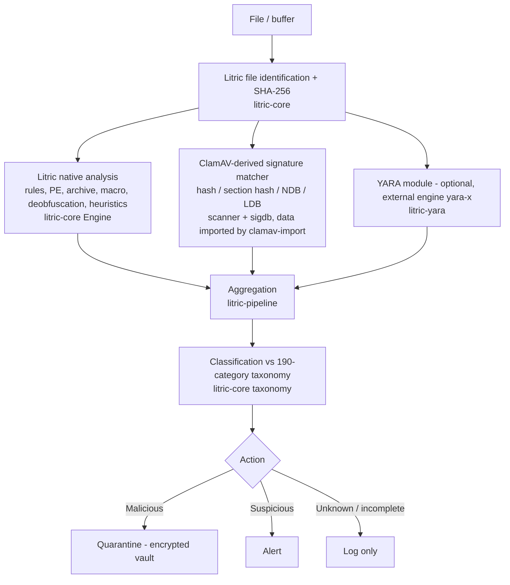

# Detection pipeline architecture (merged workspace)

Rules enforced in `litric-pipeline`:

1. Results are never merged by source: `native`, `clamav` and `yara` stay separate, each detection carries `Source`.
2. An external detection convicts only with high/critical severity and confidence ≥ 80 (medium needs ≥ 90); anything weaker is `Suspicious`.
3. `Clean` is reserved for a positive allow-list hit with a fully completed check. No detections means `Unknown`.
4. Anything not evaluated (no database, budget hit, archive members, missing PE facts, YARA timeout, no YARA rules) is listed in `incomplete`.
5. Unsigned or unknown files are never treated as malware by that fact alone (tested).

Import pipeline (offline, separate from the runtime scanner): ClamAV files → `clamav-import` → report of every unsupported line → Litric signed binary DB (`sigtool compile`/`sign`) → verified load.

Behavioural monitoring (RansomShield) feeds the service separately; it is not part of `scan_bytes` and has no OS-level enforcement in this tree.
